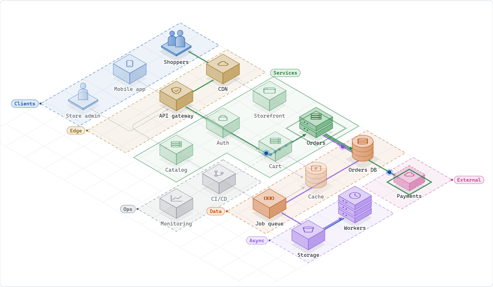
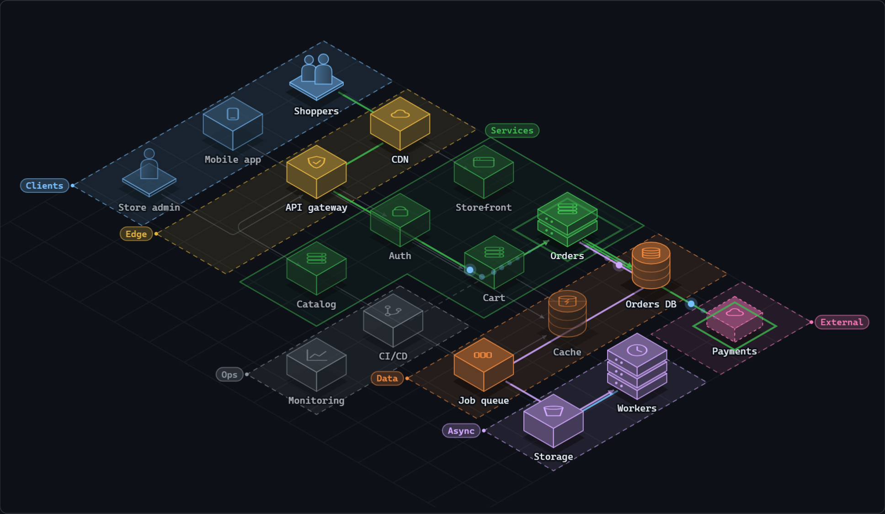

# vanilla-arch

`<canvas>` 하나에 그리는 움직이는 입체(아이소메트릭) 아키텍처 구성도.
직접 쓴 JavaScript 파일 하나와 작은 CSS 하나 — 의존성 없음, 빌드 없음, 프레임워크 없음.

[English](README.md)




- 구역 · 블록 · 연결선 · *시나리오*를 JSON 으로 적으면 입체로 그린다.
- 시나리오는 경로를 따라 패킷을 움직인다 (요청/응답, 스트림, 신호, 차단, 알림, 배포).
- 마우스를 올리면 말풍선, 누르면 `onSelect(node)`.
- 밝게/어둡게 팔레트 내장. CSS 변수를 정의해 두면 그것을 읽는다.
- 엄격한 CSP 에서도 동작: 인라인 스타일 · `eval` · `<style>` 주입 없음.
- `toDataURL()` 로 PNG, `still: true` 로 인쇄용 정지 그림.

## 빠른 시작

```html
<link rel="stylesheet" href="vanilla-arch.css">
<script src="vanilla-arch.js"></script>

<div id="diagram"></div>
<script src="app.js"></script>
```

```js
// app.js
fetch('my-system.json').then((r) => r.json()).then((data) => {
  const problems = VanillaArch.validate(data);      // 문제가 없으면 []
  if (problems.length) console.warn(problems);

  const diagram = VanillaArch.create(document.getElementById('diagram'), data, {
    onSelect: (node) => console.log('clicked', node.id)
  });
  diagram.setScenario('checkout');
});
```

**파일.** `vanilla-arch.js` 는 읽을 수 있는 원본, `vanilla-arch.min.js` 는 같은 라이브러리의 압축본이다
(65 KB → 36 KB, gzip 20.2 KB → 13.6 KB). 운영에는 `.min.js` 를 쓰면 된다. 둘 다 같은 `VanillaArch` 를 만들고,
같은 테스트 전체와 픽셀 단위 렌더 비교를 통과한다. `.min.js` 는 vanilla-kit 의 직접 만든 압축기로 만든다
(`node scripts/build-min.js`, 제3자 도구 없음). `vanilla-arch.css` 는 어느 쪽이든 필요하다.

```html
<link rel="stylesheet" href="vanilla-arch.css">
<script src="vanilla-arch.min.js"></script>
```

Node(또는 번들러)에서 `require('./vanilla-arch.js')` 하면 같은 객체가 나온다. `validate` · `iconOf` 는 DOM 없이 동작하고, `create` 만 브라우저가 필요하다.

예제 실행:

```sh
node examples/serve.mjs        # http://127.0.0.1:8080/examples/
```

## 데이터

좌표는 모두 **격자 단위**다. 격자 `x` 는 오른쪽 아래, `y` 는 왼쪽 아래, 높이는 위로. 배치는 자동이 아니다 — 블록 자리를 직접 적는다 (그래서 그림이 흔들리지 않고 diff 도 읽기 쉽다). 블록의 `x, y` 는 블록 가운데이고, 블록 한 변은 기본 0.85 칸이다. 이름이 들어가도록 블록 사이는 2칸 정도 띄운다.

```jsonc
{
  "title": "Example Shop",            // 선택: 캔버스 aria-label 에 쓴다
  "style": "iso",                     // 선택: "iso" 뿐
  "layers": [                         // 선택: 층마다 차례로 색이 정해진다
    { "id": "client", "label": "Clients" },
    { "id": "svc", "label": "Services" }
  ],
  "zones": [                          // 선택: 바닥에 깔리는 구역
    { "id": "clients", "label": "Clients", "layer": "client", "x": 0, "y": 0, "w": 2, "h": 7 },
    { "id": "svc", "label": "Services", "layer": "svc", "tone": "group",
      "pts": [[4.8, 0], [9.2, 0], [9.2, 4.6], [7, 4.6], [7, 7.2], [4.8, 7.2]], "flag": [4.8, 0] }
  ],
  "nodes": [
    { "id": "shoppers", "label": "Shoppers", "layer": "client", "x": 1, "y": 1.2 },
    { "id": "orders", "label": "Order service", "short": "Orders", "layer": "svc", "x": 8.2, "y": 1.2,
      "stack": 2, "desc": "Creates orders.", "tech": ["Go"] },
    { "id": "pay", "label": "Payment provider", "kind": "ext", "x": 13, "y": 1.2 }
  ],
  "edges": [["shoppers", "orders"], ["orders", "pay"], ["ci", "orders", "p2p"]],
  "scenarios": [
    { "id": "checkout", "label": "Checkout", "flows": [
      { "path": ["shoppers", "orders"], "kind": "req", "back": true, "every": 2600 },
      { "path": ["orders", "pay"], "kind": "req", "back": true, "delay": 800 }
    ] }
  ]
}
```

### `nodes[]` (필수)

| 필드 | 형식 | 뜻 |
|---|---|---|
| `id` | string | 고유 id (필수) |
| `label` | string | 전체 이름. 말풍선과 블록 이름에 쓴다 (없으면 `id`) |
| `x`, `y` | number | 블록 가운데, 격자 단위 (필수) |
| `short` | string | 블록 밑에 쓰는 짧은 이름. 말풍선은 `label` 그대로 |
| `desc` | string | 말풍선 설명 |
| `layer` | string | 블록 색을 정하는 층 id (없으면 강조색) |
| `icon` | string | [아이콘 이름](#아이콘) 중 하나. 없으면 규칙으로 고른다 |
| `kind` | `"ext"` \| `"bad"` | `ext`: 점선의 낮은 상자 (외부 시스템), 아이콘 기본 `cloud`. `bad`: `c6` 색 (`block` 흐름과 같은 색) |
| `s` | number | 바닥 한 변 (기본 `0.85`) |
| `stack` | number | N대를 층층이 쌓아 그린다 (서버 묶음) |
| `tech` | string[] | 아이콘 고르기에 함께 쓰는 단어 |

블록 모양은 아이콘을 따른다. `db` · `cache` 는 원기둥, `users` · `person` 은 서 있는 사람, 나머지는 윗면에 아이콘을 그린 상자다.

### `edges[]`

`[fromId, toId, kind?]`. 선은 바닥 위를 격자 방향으로만 (한 번까지 꺾어) 가고, 다른 블록 밑을 덜 지나는 길을 고른다. `kind: "p2p"` 는 점선. 없는 id 를 가리키는 선은 건너뛴다.

### `zones[]`

사각형 `{ x, y, w, h }` (왼쪽 위 칸 + 크기) 또는 다각형 `{ pts: [[x, y], …] }`. 선택 필드:

- `label` 을 주면 작은 깃발이 붙는다. 깃발은 블록 · 이름 · 다른 깃발과 겹치지 않는 자리에 꽂힌다. `flag: [x, y]` 를 주면 그 꼭짓점을 먼저 고른다.
- `layer` 는 구역 색을 정한다 (없으면 회색).
- `tone: "group"` 은 실선 테두리 (묶음 구역에 맞다). 나머지 구역은 점선이다.

### `layers[]`

`{ id, label }`. 층은 팔레트에서 차례로 색을 받는다 (`c3, c5, accent, warm, c4, c8, c6`, 반복). `layers` 가 없으면 노드 · 구역에 적힌 layer id 를 나온 순서대로 모아 쓴다. 이름은 캔버스 `aria-label` 에 들어간다.

### `scenarios[]`

`{ id, label?, desc?, flows: [...] }`. 라이브러리는 `id` 와 `flows` 만 읽는다. `label` · `desc` 등은 화면을 만들 때 쓰면 된다.

흐름 하나는 `{ path: [id, id, …], kind, back?, every?, delay? }`:

| 필드 | 뜻 |
|---|---|
| `path` | 노드 id 두 개 이상. 연결선이 없는 구간은 시나리오에서만 점선으로 그린다 |
| `kind` | `req`, `res`, `stream`, `signal`, `p2p`, `block`, `alert`, `deploy` (색). `block` 은 마지막 블록 위에 × 를 그린다 |
| `back` | 도착하면 같은 길로 돌아온다 (`req` 는 `res` 로 돌아온다) |
| `every` | 반복 간격 ms (기본 1800) |
| `delay` | 시작 시차 ms (기본 0) |

시나리오가 켜지면 그 노드 · 선이 진해지고 나머지는 살짝만 흐려진다 (전체가 계속 읽힌다).

### `VanillaArch.validate(data)`

순수 함수다. 문제가 없으면 `[]`, 있으면 읽을 수 있는 문장 목록을 돌려준다. 잡는 문제:

- 중복되거나 빠진 id, 숫자가 아닌 `x`/`y`
- 선 · 흐름의 없는 노드 id, 너무 짧은 흐름 경로
- 모르는 layer · 아이콘 · 흐름 kind
- 잘못된 구역, 잘못된 `s`/`stack`/`every`/`delay`
- 캔버스 하나에 담기에 너무 넓은 좌표 범위 (아래 *캔버스 크기 제한*)

`create` 는 잘못된 데이터에도 던지지 않는다. 그릴 수 없는 것은 건너뛴다.

### 캔버스 크기 제한

브라우저는 일정 크기를 넘는 캔버스를 거부하거나 빈 화면으로 둔다(iOS Safari 는 전체 16,777,216 픽셀).
캔버스 크기는 좌표를 따라가므로 `VanillaArch.LIMITS` 로 묶는다: 한 변 최대 `maxSide`(8192) CSS px, 기기 픽셀 비율을
곱한 실제 픽셀 최대 `maxPixels`(16,777,216). 너무 큰 캔버스는 먼저 픽셀 비율을 낮추고, 좌표가 너무 넓게 퍼진
그림은 칸 크기를 읽기 좋은 최소값 아래로 줄인다(전체가 작아지고 글자가 겹칠 수 있다). 오류는 던지지 않고,
`validate()` 가 그런 좌표 범위를 알려 준다.

## 옵션

`VanillaArch.create(host, data, opts)`:

| 옵션 | 기본값 | 뜻 |
|---|---|---|
| `onSelect(node)` | 없음 | 누르면 (휴대폰 탭 포함) 넘긴 노드 객체로 부른다 |
| `still` | `false` | 움직이지 않는 한 장 (인쇄 · 내보내기) |
| `dpr` | `min(2, devicePixelRatio)` | 해상도 배율. 선명한 인쇄 그림이면 `2` |
| `palette` | 없음 | `{ bg, panel, line, fg, muted, faint, accent, warm, c3, c4, c5, c6, c8 }`. 일부만 줘도 되고, CSS 색이면 무엇이든 된다. 다른 모든 것보다 먼저 |
| `theme` | `"auto"` | `"light"` / `"dark"` 는 내장 팔레트를 고정한다. `"auto"` 는 `<html data-theme>` → `<html class="dark">` → `prefers-color-scheme` 순서로 따른다 |
| `tokenPrefix` | `"--va-"` | 읽을 CSS 변수의 접두사 (`--va-bg`, `--va-accent`, …, `--va-mono`). `false` 면 CSS 변수를 읽지 않는다 |
| `font` | 토큰 `<prefix>mono`, 없으면 고정폭 글꼴 목록 | 캔버스 글꼴 |
| `iconRules` | 내장 목록 | `[[아이콘, RegExp], …]`. 기본 규칙을 통째로 바꾼다 |
| `ariaLabel` | 제목 + 층 이름 | 캔버스의 접근성 이름 |

### 돌려받는 객체

| 메서드 | |
|---|---|
| `setScenario(id)` | 시나리오를 튼다. 없는 id 나 `''` 면 끈다 |
| `select(id)` | 블록을 고른다 (누른 것과 같지만 `onSelect` 는 부르지 않는다). `null` 이면 해제 |
| `toDataURL()` | `{ url, width, height, canvas }`. `url` 은 배경이 투명한 PNG, `width`/`height` 는 CSS px |
| `destroy()` | 움직임을 멈추고 모든 관찰자 · 이벤트를 떼고, 캔버스 · 말풍선 · 화면 밖 그림을 지운다 |

`VanillaArch` 에는 `version`, `ICONS`, `ICON_RULES`, `FLOW_KINDS`, `LIGHT`, `DARK` (고정됨), `iconOf(node, rules?)` 도 있다.

## 아이콘

`users` `person` `mobile` `browser` `server` `db` `cache` `bucket` `queue` `lambda` `cloud` `shield` `bolt` `chip` `doc` `clock` `chart` `bell` `lock` `git`

모르는 이름은 둥근 네모로 그린다.

노드에 `icon` 이 없으면 `id` · `label` · `tech` (소문자) 를 `ICON_RULES` 에 차례로 맞춰 보고, 처음 맞는 것을 쓴다. `kind: "ext"` 는 `cloud`. 기본 규칙은 흔한 영어 용어와 일반적인 한국어 낱말 몇 개를 안다 (사용자 · 고객 · 관리자 · 모바일 · 알림 · 모니터링 · 배포 · 인증 · 게이트웨이 · 큐 · 캐시 · 저장소 · 데이터베이스 · 배치 · 외부 · 웹 …). 전체 표는 [README.md](README.md#icons) 에 있다.

내 규칙을 앞에 붙이려면:

```js
VanillaArch.create(host, data, {
  iconRules: [['chip', /robot|vision/], ['doc', /invoice/]].concat(VanillaArch.ICON_RULES)
});
```

## 테마

색은 키마다 다음 순서로 고른다.

1. `opts.palette[key]`
2. CSS 변수 `<tokenPrefix><key>` (기본 `--va-bg`, `--va-accent`, …). 단 호스트에서 **실제로 정의되어 있을 때만**
3. 내장 `LIGHT` / `DARK`. `opts.theme`, `<html data-theme>`, `<html class="dark">`, `prefers-color-scheme` 순서로 고른다

정의되지 않은 변수는 알아보고 건너뛴다. 그래서 아무 CSS 없는 페이지에서도 한 가지 색으로 뭉개지지 않는다. `<html>` 의 `data-theme` · `class` 와 OS 색 설정이 바뀌면 바로 따라간다.

이미 쓰는 디자인 토큰이 있으면 `tokenPrefix` 로 가리킨다. 예: `{ tokenPrefix: '--my-' }` 와 `--my-bg`, `--my-fg`, `--my-accent`, `--my-c3`, ….

키: `bg` (캔버스 배경 · 이름 테두리), `panel` (말풍선), `line` (바닥 격자), `fg` (이름), `muted` (쉬는 선), `faint`, `accent` (고름 · `req`/`p2p` · 층 없는 블록), `warm` (`alert`), 범주색 `c3`, `c4`, `c5`, `c6`, `c8`. 흐름 색은 `req` → accent, `res`/`stream` → c3, `signal` → c4, `block` → c6, `alert` → warm, `deploy` → c5.

라이브러리는 실제로 그리는 팔레트로 호스트에 `--va-ui-bg`, `--va-ui-panel`, `--va-ui-line`, `--va-ui-fg`, `--va-ui-muted`, `--va-ui-font` 를 적는다. `vanilla-arch.css` 가 이것으로 배경과 말풍선을 칠하므로 HTML 과 캔버스 색이 늘 맞는다. `.va-wrap` · `.va-tip` 은 내 CSS 로 덮어써도 된다.

## CSS

`create` 는 호스트에 `va-wrap` · `is-iso` 클래스를 붙이고 `destroy` 때 뗀다. `vanilla-arch.css` 에는 다음만 들어 있다.

- `.va-wrap`: `position: relative` 와 배경
- `.va-wrap.is-iso`: 그림이 호스트보다 넓으면 호스트 안에서만 가로로 민다
- `.va-canvas`
- `.va-tip`, `.va-tip b`: 말풍선

테두리 · 여백은 페이지가 정한다.

## 성능

- **멈춘 층 캐시.** 격자 · 구역 · 선 · 블록 · 깃발 · 이름은 화면 밖 캔버스에 한 번 그려 둔다. 프레임마다 그 그림을 붙이고 패킷 · 도착 표시만 그린다. 크기 · 테마 · 마우스 올림 · 고름 · 시나리오가 바뀔 때만 다시 그린다.
- **초당 30장.** `requestAnimationFrame` 을 쓰되 33ms 보다 가까운 프레임은 건너뛴다.
- **쉬기.** 18초 동안 입력이나 시나리오 바꿈이 없으면 패킷을 지우고 멈춘다. 마우스 올림 · 누르기 · 터치 · 화면에 다시 들어옴 · 탭으로 돌아옴이 있으면 다시 움직인다.
- **안 보이면 멈춤.** `IntersectionObserver` (화면 밖) 와 `visibilitychange` (숨은 탭) 로 멈춘다.
- **움직임 줄이기.** `prefers-reduced-motion: reduce` (또는 `still: true`) 면 움직이지 않고, 시나리오 경로만 화살표로 보여 준다.
- **크기.** `ResizeObserver` 로 다음 프레임에 다시 배치한다. 호스트가 좁아지면 칸 크기를 읽을 수 있는 최소까지 줄이고, 그래도 넘치면 호스트 안에서 가로로 민다 (마우스로 끌어도 된다).
- **정리.** `destroy()` 는 화면 밖 캔버스 메모리와 모든 관찰자 · 이벤트를 돌려준다.

## CSP

`eval` · `new Function` · 인라인 `<style>` · `setAttribute('style', …)` · `innerHTML` 을 쓰지 않는다. `element.style` 의 개별 속성과 CSS 변수만 CSSOM 으로 바꾼다 (CSP 가 허용한다). 예제 페이지는 다음 정책으로 돈다.

```
default-src 'self'; script-src 'self'; style-src 'self'; img-src 'self' data:; connect-src 'self'
```

(`img-src data:` 는 `toDataURL()` 결과를 `` 로 보여 줄 때만 필요하다.)

## 지원 브라우저

Canvas 2D (`ellipse`, `arcTo`), `MutationObserver`, `Math.hypot` 이 있는 요즘 브라우저. `ResizeObserver` · `IntersectionObserver` · `matchMedia` 는 있으면 쓰고 없으면 건너뛴다. 소스는 ES5 문법이라 변환이 필요 없다. 개발 · 확인은 Chromium 에서 했다.

## 테스트

```sh
node --test
```

테스트는 의존성이 없다. `validate`, `iconOf`, 캔버스 크기 제한, 일반 스크립트 · CommonJS 로 불러오기를 확인한다.
`test/min.test.js` 는 테스트 전체를 `vanilla-arch.min.js` 로 한 번 더 돌리고(`VANILLA_ARCH_MIN=1 node --test` 는 그것만),
옆에 vanilla-kit 이 있으면(또는 `VANILLA_KIT`) `.min.js` 가 최신인지 확인한다. 변경 내역은 [CHANGELOG.md](CHANGELOG.md).

## 라이선스

[MIT](LICENSE) © 2026 FEABE
