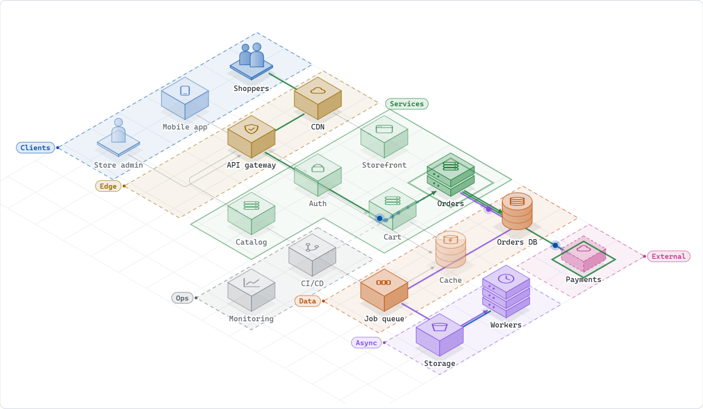
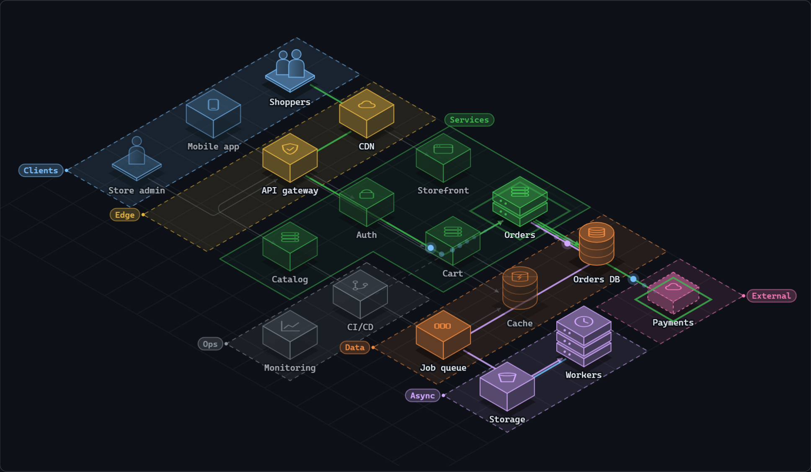

# vanilla-arch

Animated isometric architecture diagrams on a single `<canvas>`.
One hand-written JavaScript file plus a small stylesheet: no dependencies, no build step, no framework.

[한국어](README.ko.md)




- You describe zones, blocks, edges and *scenarios* in JSON; the library draws them in an isometric view.
- Scenarios animate packets along paths (requests and responses, streams, signals, blocked calls, alerts, deploys).
- Hover shows a tooltip, click calls your `onSelect(node)`.
- Light and dark palettes are built in. It also reads your CSS custom properties when you define them.
- It works under a strict Content Security Policy: no inline styles, no `eval`, no injected `<style>`.
- `toDataURL()` exports a PNG, and `still: true` renders a static image for print.

## Quick start

```html
<link rel="stylesheet" href="vanilla-arch.css">
<script src="vanilla-arch.js"></script>

<div id="diagram"></div>
<script src="app.js"></script>
```

```js
// app.js
fetch('my-system.json').then((r) => r.json()).then((data) => {
  const problems = VanillaArch.validate(data);      // [] when the data is fine
  if (problems.length) console.warn(problems);

  const diagram = VanillaArch.create(document.getElementById('diagram'), data, {
    onSelect: (node) => console.log('clicked', node.id)
  });
  diagram.setScenario('checkout');
});
```

In Node (or a bundler), `require('./vanilla-arch.js')` returns the same object. `validate` and `iconOf` work without a DOM. Only `create` needs a browser.

Try the example locally:

```sh
node examples/serve.mjs        # http://127.0.0.1:8080/examples/
```

## Data

Every coordinate is in **grid units**. Grid `x` runs to the lower right, `y` to the lower left, and height goes up. Layout is never automatic: you place every block, which keeps diagrams stable and diff-friendly. A block's `x, y` is its center, and a block is 0.85 units wide by default. Leave about 2 units between blocks so the labels fit.

```jsonc
{
  "title": "Example Shop",            // optional, used for the canvas aria-label
  "style": "iso",                     // optional; "iso" is the only style
  "layers": [                         // optional: colors are assigned to layers in order
    { "id": "client", "label": "Clients" },
    { "id": "svc", "label": "Services" }
  ],
  "zones": [                          // optional floor plates
    { "id": "clients", "label": "Clients", "layer": "client", "x": 0, "y": 0, "w": 2, "h": 7 },
    { "id": "svc", "label": "Services", "layer": "svc", "tone": "group",
      "pts": [[4.8, 0], [9.2, 0], [9.2, 4.6], [7, 4.6], [7, 7.2], [4.8, 7.2]], "flag": [4.8, 0] }
  ],
  "nodes": [
    { "id": "shoppers", "label": "Shoppers", "layer": "client", "x": 1, "y": 1.2 },
    { "id": "orders", "label": "Order service", "short": "Orders", "layer": "svc", "x": 8.2, "y": 1.2,
      "stack": 2, "desc": "Creates orders.", "tech": ["Go"] },
    { "id": "pay", "label": "Payment provider", "kind": "ext", "x": 13, "y": 1.2 }
  ],
  "edges": [["shoppers", "orders"], ["orders", "pay"], ["ci", "orders", "p2p"]],
  "scenarios": [
    { "id": "checkout", "label": "Checkout", "flows": [
      { "path": ["shoppers", "orders"], "kind": "req", "back": true, "every": 2600 },
      { "path": ["orders", "pay"], "kind": "req", "back": true, "delay": 800 }
    ] }
  ]
}
```

### `nodes[]` (required)

| field | type | meaning |
|---|---|---|
| `id` | string | unique id (required) |
| `label` | string | full name, used in the tooltip and as the block label (defaults to `id`) |
| `x`, `y` | number | center of the block in grid units (required) |
| `short` | string | shorter label drawn under the block. The tooltip still shows `label`. |
| `desc` | string | tooltip body |
| `layer` | string | layer id that sets the block color (the accent color when it is missing) |
| `icon` | string | one of the [icon names](#icons). If you leave it out, the icon rules pick one. |
| `kind` | `"ext"` \| `"bad"` | `ext`: a dashed, lower box (a third-party system), with a `cloud` icon by default. `bad`: drawn in the `c6` color (the same color as `block` flows). |
| `s` | number | footprint size (default `0.85`) |
| `stack` | number | draws N stacked units (a server cluster) |
| `tech` | string[] | extra words for icon matching |

The icon also decides the block's shape. `db` and `cache` draw a cylinder, `users` and `person` draw standing figures, and every other icon draws a box with the icon on its top face.

### `edges[]`

`[fromId, toId, kind?]`. Edges run along the floor in grid directions with at most one bend, choosing the route that passes under fewer blocks. `kind: "p2p"` draws a dashed line. Edges that name unknown ids are skipped.

### `zones[]`

Either a rectangle `{ x, y, w, h }` (top-left corner plus size) or a polygon `{ pts: [[x, y], ...] }`. Optional fields:

- `label` adds a small flag. The library places it where it does not cover blocks, labels or other flags. `flag: [x, y]` asks for a specific corner first.
- `layer` sets the zone color (grey when it is missing).
- `tone: "group"` draws a solid outline, which suits grouping zones. Other zones get a dashed outline.

### `layers[]`

`{ id, label }`. Layers take colors in order from the palette (`c3, c5, accent, warm, c4, c8, c6`, repeating). When `layers` is missing, the library builds the list from the layer ids it finds on nodes and zones, in order of appearance. The labels become part of the canvas `aria-label`.

### `scenarios[]`

`{ id, label?, desc?, flows: [...] }`. The library only reads `id` and `flows`. You can keep `label`, `desc` or anything else for your own UI.

Each flow is `{ path: [id, id, ...], kind, back?, every?, delay? }`:

| field | meaning |
|---|---|
| `path` | node ids, at least two. A hop that is not an edge is drawn as a dashed scenario-only line. |
| `kind` | `req`, `res`, `stream`, `signal`, `p2p`, `block`, `alert`, `deploy` (sets the color). `block` ends with an × on the last block. |
| `back` | after arriving, a packet returns along the same path (`req` comes back as `res`) |
| `every` | repeat interval in ms (default 1800) |
| `delay` | start offset in ms (default 0) |

While a scenario is active, its nodes and edges are highlighted and everything else is dimmed slightly, so the whole diagram stays readable.

### `VanillaArch.validate(data)`

This pure function returns an array of readable problems, or `[]` when the data is fine. It reports:

- duplicate or missing ids, and non-numeric `x`/`y`
- unknown node ids in edges and flows, and flow paths that are too short
- unknown layers, icons and flow kinds
- malformed zones, and bad `s`/`stack`/`every`/`delay`

`create` never throws on bad data. It skips anything it cannot draw.

## Options

`VanillaArch.create(host, data, opts)`:

| option | default | meaning |
|---|---|---|
| `onSelect(node)` | none | called on click or tap with the node object you passed in |
| `still` | `false` | no animation; draws one static frame (for print or export) |
| `dpr` | `min(2, devicePixelRatio)` | backing-store scale, for example `2` for crisp print images |
| `palette` | none | `{ bg, panel, line, fg, muted, faint, accent, warm, c3, c4, c5, c6, c8 }`, any subset, any CSS color. It overrides everything else. |
| `theme` | `"auto"` | `"light"` or `"dark"` forces a built-in palette. `"auto"` follows `<html data-theme>`, then `<html class="dark">`, then `prefers-color-scheme`. |
| `tokenPrefix` | `"--va-"` | prefix of CSS custom properties to read (`--va-bg`, `--va-accent`, …, `--va-mono`). Pass `false` to ignore CSS variables. |
| `font` | token `<prefix>mono`, or a monospace stack | canvas font family |
| `iconRules` | built-in list | `[[iconName, RegExp], ...]` that replaces the default rules |
| `ariaLabel` | title plus the layer names | accessible name of the canvas |

### Returned handle

| method | |
|---|---|
| `setScenario(id)` | plays a scenario. An unknown id or `''` clears it. |
| `select(id)` | highlights a block (the same as a click, without `onSelect`). `null` clears it. |
| `toDataURL()` | `{ url, width, height, canvas }`. `url` is a PNG with a transparent background, and `width`/`height` are in CSS px. |
| `destroy()` | stops the animation, disconnects every observer and listener, and removes the canvas, tooltip and offscreen cache |

`VanillaArch` also exposes `version`, `ICONS`, `ICON_RULES`, `FLOW_KINDS`, `LIGHT`, `DARK` (frozen) and `iconOf(node, rules?)`.

## Icons

`users` `person` `mobile` `browser` `server` `db` `cache` `bucket` `queue` `lambda` `cloud` `shield` `bolt` `chip` `doc` `clock` `chart` `bell` `lock` `git`

An unknown name is drawn as a plain rounded square.

When a node has no `icon`, the library matches `id`, `label` and `tech` (lowercased) against `ICON_RULES`, and the first match wins. `kind: "ext"` nodes get `cloud`. The defaults understand common English terms and a few generic Korean words, for example:

| icon | matches (excerpt) |
|---|---|
| users | users, customer, visitor, member, 사용자, 고객 |
| person | admin, operator, staff, 관리자, 운영자 |
| mobile | mobile, ios, android, 모바일 |
| bell | notification, alert, email, sms, push, 알림 |
| chart | logs, metrics, monitoring, dashboard, 모니터링 |
| git | git, ci, pipeline, build, 배포 |
| lock | auth, login, oauth, sso, 인증 |
| shield | gateway, firewall, waf, proxy, load balancer, edge, 게이트웨이 |
| bolt | websocket, webhook, realtime, events |
| queue | queue, kafka, rabbit, mq, pub/sub, 큐 |
| lambda | lambda, serverless, function |
| cache | cache, redis, memcache, 캐시 |
| bucket | storage, bucket, s3, blob, cdn, files, 저장소 |
| db | database, db, postgres, mysql, mongo, sqlite, 데이터베이스 |
| chip | ai, ml, gpu, llm, model, inference |
| doc | report, policy, rules, docs, config |
| clock | cron, batch, scheduler, worker, jobs, 배치 |
| cloud | cloud, aws, gcp, azure, external, saas, 외부 |
| browser | web, browser, frontend, spa, react, 웹 |
| server | everything else |

To add your own rules, put them in front of the defaults:

```js
VanillaArch.create(host, data, {
  iconRules: [['chip', /robot|vision/], ['doc', /invoice/]].concat(VanillaArch.ICON_RULES)
});
```

## Theming

The library picks colors per key, in this order:

1. `opts.palette[key]`
2. the CSS custom property `<tokenPrefix><key>` (default `--va-bg`, `--va-accent`, …), **only when it is actually defined** for the host
3. the built-in `LIGHT` or `DARK` palette, chosen by `opts.theme`, `<html data-theme>`, `<html class="dark">` or `prefers-color-scheme`

Undefined variables are detected and ignored, so a bare page still gets a proper palette instead of one inherited color. Changes to `data-theme` or `class` on `<html>`, and to the OS color scheme, are picked up live.

To reuse an existing design-token set, point `tokenPrefix` at it, for example `{ tokenPrefix: '--my-' }` with `--my-bg`, `--my-fg`, `--my-accent`, `--my-c3`, ….

Keys: `bg` (canvas background, label halo), `panel` (tooltip), `line` (floor grid), `fg` (labels), `muted` (idle edges), `faint`, `accent` (selection, `req`/`p2p`, layerless blocks), `warm` (`alert`), and the categorical colors `c3`, `c4`, `c5`, `c6`, `c8`. `C.kind` maps flow kinds as follows: `req` → accent, `res`/`stream` → c3, `signal` → c4, `block` → c6, `alert` → warm, `deploy` → c5.

The library sets `--va-ui-bg`, `--va-ui-panel`, `--va-ui-line`, `--va-ui-fg`, `--va-ui-muted` and `--va-ui-font` on the host, from the palette it draws with. `vanilla-arch.css` uses them for the wrap background and the tooltip, so HTML and canvas always match. You can override `.va-wrap` and `.va-tip` in your own CSS.

## CSS

`create` adds the `va-wrap` and `is-iso` classes to the host and removes them on `destroy`. `vanilla-arch.css` contains only:

- `.va-wrap`: `position: relative` and the background
- `.va-wrap.is-iso`: horizontal scrolling inside the host when the drawing is wider than the host
- `.va-canvas`
- `.va-tip`, `.va-tip b`: the tooltip

Borders, padding and margins belong to your page.

## Performance

- **Static layer cache.** The grid, zones, edges, blocks, flags and labels are drawn once into an offscreen canvas. Each frame copies that image and draws only the moving packets and arrival marks. The cache is redrawn only when the size, theme, hover, selection or scenario changes.
- **30 fps cap.** `requestAnimationFrame` runs, but frames closer than about 33 ms apart are skipped.
- **Idle nap.** After 18 s with no pointer input or scenario change, packets are cleared and the loop stops. The next hover, click, touch, scroll back into view or tab focus wakes it.
- **Off-screen pause.** An `IntersectionObserver` stops drawing while the canvas is out of view, and `visibilitychange` stops it in background tabs.
- **Reduced motion.** Under `prefers-reduced-motion: reduce` (or `still: true`), nothing animates. Scenario paths are still highlighted with arrows.
- **Resize.** A `ResizeObserver` relays out on the next frame. The cell size shrinks with the host down to a readable minimum, then the drawing scrolls sideways inside the host. You can also drag it with the mouse.
- **Cleanup.** `destroy()` releases the offscreen canvas memory and every observer and listener.

## CSP

The library never uses `eval`, `new Function`, inline `<style>`, `setAttribute('style', …)` or `innerHTML`. It sets individual `element.style` properties and custom properties through the CSSOM, which CSP allows. The example page runs under:

```
default-src 'self'; script-src 'self'; style-src 'self'; img-src 'self' data:; connect-src 'self'
```

(`img-src data:` is only needed if you display `toDataURL()` output in an ``.)

## Browser support

Any current evergreen browser with Canvas 2D (`ellipse`, `arcTo`), `MutationObserver` and `Math.hypot`. `ResizeObserver`, `IntersectionObserver` and `matchMedia` are used when they exist and skipped when they do not. The source is ES5-style syntax, so no transpiling is needed. It is developed and checked in Chromium.

## Tests

```sh
node --test
```

The tests have no dependencies. They cover `validate`, `iconOf` and loading as a classic script or a CommonJS module.

## License

[MIT](LICENSE) © 2026 FEABE
